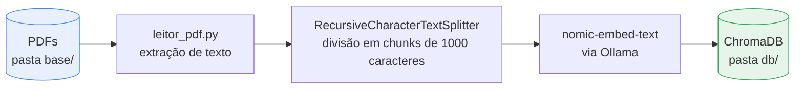
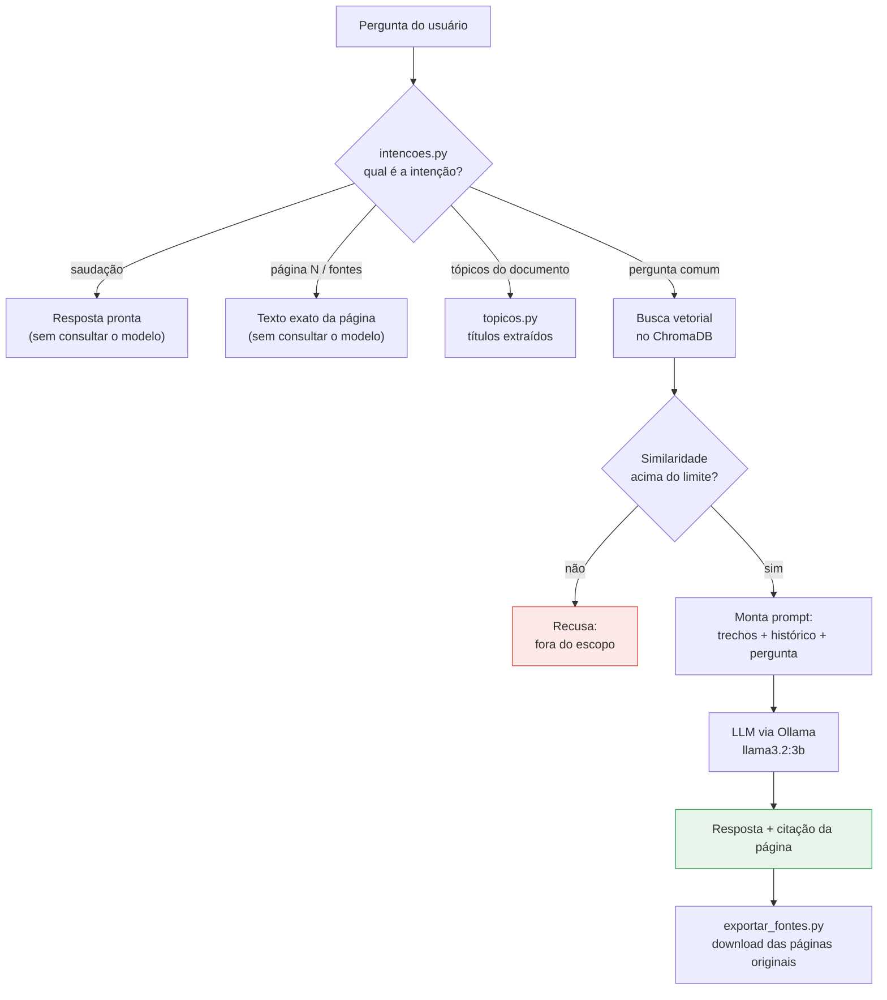

# Consulta Técnica RAG

**RAG local com Ollama** · Protótipo de um assistente de perguntas e respostas sobre documentos PDF,
executado **inteiramente na máquina local**, sem envio de dados para serviços
externos. Desenvolvido como prova de conceito para Trabalho de Conclusão de
Curso em Engenharia de Produção.

O sistema implementa a arquitetura **RAG** (*Retrieval-Augmented Generation*):
em vez de confiar no conhecimento interno do modelo de linguagem, ele **busca
trechos relevantes nos documentos fornecidos** e só então gera a resposta,
sempre citando a página de origem.

---

## Por que isso importa

Manuais técnicos, procedimentos operacionais e documentos de contrato são
longos e pouco consultados na prática — encontrar uma informação específica
custa tempo. Um assistente que responde em linguagem natural **e aponta a
página exata da fonte** reduz esse tempo de consulta e, principalmente,
permite que o usuário **verifique a resposta no documento original**.

A execução local é um requisito de projeto: documentos internos de uma
organização não precisam sair da infraestrutura própria.

---

## Funcionalidades

| Funcionalidade | Descrição |
|---|---|
| **Perguntas em linguagem natural** | Interface de chat no navegador, com resposta exibida progressivamente |
| **Citação de fontes** | Toda resposta informa arquivo e página de onde a informação foi extraída |
| **Download da fonte original** | Botão que recorta as páginas originais do PDF e entrega como arquivo |
| **Controle de escopo** | Perguntas fora do assunto dos documentos são recusadas em vez de respondidas com invenção |
| **Memória de conversa** | Perguntas de continuação ("e o preço dele?") são reescritas usando o histórico |
| **Lista de tópicos** | Detecta automaticamente os títulos numerados do documento |
| **Exportação em PDF** | Gera PDF da resposta, da conversa ou das páginas originais |
| **Consulta por página** | "conteúdo da página 3", "primeira página", "última página" |

---

## Arquitetura

O sistema tem dois fluxos independentes: **indexação** (executada uma vez, ou
sempre que os documentos mudam) e **consulta** (a cada pergunta).

### Fluxo 1 — Indexação (`criar_db.py`)



Cada trecho do documento é convertido em um **vetor numérico** (*embedding*)
que representa seu significado. Esses vetores são armazenados no banco
vetorial, permitindo busca por similaridade semântica em vez de busca por
palavra exata.

### Fluxo 2 — Consulta (`app.py`)



**Decisão de projeto relevante:** nem toda pergunta passa pelo modelo de
linguagem. Saudações, pedidos de página e listagem de tópicos são resolvidos
diretamente em Python. Isso reduz o tempo de resposta e elimina a chance de
o modelo inventar informação nesses casos.

---

## Tecnologias

| Componente | Escolha | Justificativa |
|---|---|---|
| Modelo de linguagem | **Llama 3.2 3B** (via Ollama) | Executa em CPU comum; modelos maiores exigem GPU dedicada |
| Embeddings | **nomic-embed-text** | Bom desempenho em português e execução local |
| Banco vetorial | **ChromaDB** | Persistência em disco sem necessidade de servidor |
| Orquestração | **LangChain** | Abstrai a integração entre leitor, divisor, banco e modelo |
| Interface | **Streamlit** | Interface web funcional com baixo esforço de desenvolvimento |
| Manipulação de PDF | **pypdf** (leitura/recorte) e **fpdf2** (geração) | Recorte preserva o documento original; geração cria relatórios |

Todo o processamento ocorre localmente. **Nenhum dado é enviado para APIs
externas.**

---

## Instalação

### Pré-requisitos

1. **Python 3.10 ou superior** — [python.org](https://www.python.org/downloads/)
2. **Ollama** — [ollama.com](https://ollama.com)

### Passo a passo

```bash
# 1. Clonar o repositório
git clone https://github.com/renan-armac/consulta-tecnica-rag.git
cd consulta-tecnica-rag

# 2. Instalar as dependências Python
pip install -r requirements.txt

# 3. Baixar os modelos (uma única vez, cerca de 2 GB)
ollama pull nomic-embed-text
ollama pull llama3.2:3b

# 4. Indexar os documentos da pasta base/
python criar_db.py

# 5. Abrir a interface
streamlit run app.py
```

No Windows, o arquivo `iniciar_chat.bat` executa os passos 4 e 5 com dois cliques.

### Usando seus próprios documentos

Coloque os arquivos PDF na pasta `base/` e execute `python criar_db.py`
novamente. O repositório inclui um documento de exemplo fictício
(`base/manual-exemplo.pdf`) para que o projeto funcione imediatamente após a
instalação.

---

## Estrutura do projeto

```
consulta-tecnica-rag/
├── app.py                 Interface de chat (Streamlit)
├── main.py                Versão em linha de comando
├── criar_db.py            Indexação: PDFs → banco vetorial
├── rag_core.py            Núcleo: busca, roteamento e configurações
├── embeddings.py          Configuração do modelo de embeddings
├── leitor_pdf.py          Extração e limpeza de texto dos PDFs
├── intencoes.py           Classificação da intenção da pergunta
├── topicos.py             Detecção dos títulos do documento
├── pdf_utils.py           Geração de PDF a partir das respostas
├── exportar_fontes.py     Recorte das páginas originais do PDF
├── requirements.txt
├── base/                  Documentos PDF (apenas o exemplo é versionado)
├── db/                    Banco vetorial (gerado localmente)
└── docs/
    ├── PASSO_A_PASSO.md   Guia detalhado de uso e evolução do protótipo
    └── gerar_pdf_exemplo.py
```

---

## Configuração

Todos os parâmetros ficam no início de `rag_core.py`:

| Parâmetro | Padrão | Efeito |
|---|---|---|
| `MODELO_LLM` | `llama3.2:3b` | Modelo gerador. Maiores respondem melhor, porém mais devagar |
| `K_RESULTADOS` | `3` | Quantidade de trechos enviados ao modelo |
| `LIMITE_RELEVANCIA` | `0.6` | Similaridade mínima para considerar a pergunta dentro do escopo |
| `TURNOS_DE_MEMORIA` | `6` | Mensagens recentes mantidas no contexto |

### Calibração do limite de relevância

Este é o parâmetro mais sensível do sistema. Com `MOSTRAR_SCORES = True`, a
interface exibe a pontuação de similaridade de cada consulta. O procedimento
de calibração consiste em registrar as pontuações de perguntas claramente
dentro do escopo e de perguntas fora dele, e fixar o limite entre os dois
grupos. Valores altos demais rejeitam perguntas legítimas; valores baixos
demais permitem respostas sem fundamento no documento.

---

## Limitações conhecidas

- **Desempenho da indexação:** documentos extensos (acima de algumas centenas
  de páginas) levam tempo considerável para serem vetorizados em CPU. A
  indexação atual é integral, não incremental.
- **Capacidade do modelo:** o Llama 3.2 3B ocasionalmente não segue a
  instrução de restrição ao contexto. O sistema detecta e trata essas
  recusas, mas modelos maiores apresentam comportamento mais consistente.
- **PDFs digitalizados:** documentos compostos por imagens não têm texto
  extraível. Seria necessário OCR, não implementado neste protótipo.
- **Persistência da conversa:** o histórico existe apenas durante a sessão do
  navegador e é perdido ao recarregar a página.
- **Separação entre documentos:** o limite de relevância é global, não
  ajustado por tipo de documento.

---

## Trabalhos futuros

- Indexação incremental, processando apenas documentos novos ou alterados
- OCR para documentos digitalizados
- Avaliação quantitativa da qualidade das respostas com conjunto de perguntas
  de referência
- Reclassificação dos trechos recuperados (*reranking*) antes do envio ao modelo

---

## Licença

Distribuído sob a licença MIT. Consulte o arquivo [LICENSE](LICENSE).

O documento em `base/manual-exemplo.pdf` tem conteúdo **fictício**, criado
exclusivamente para demonstração.
